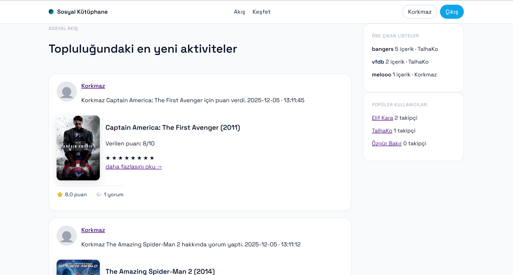
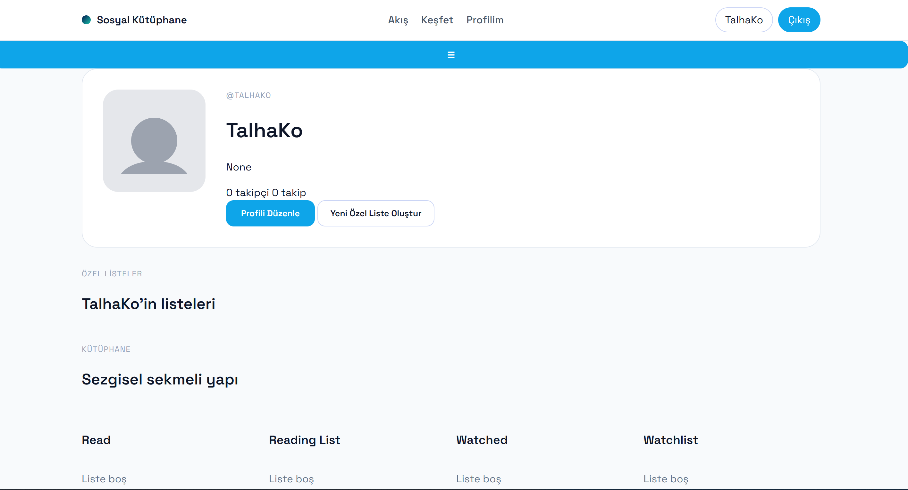
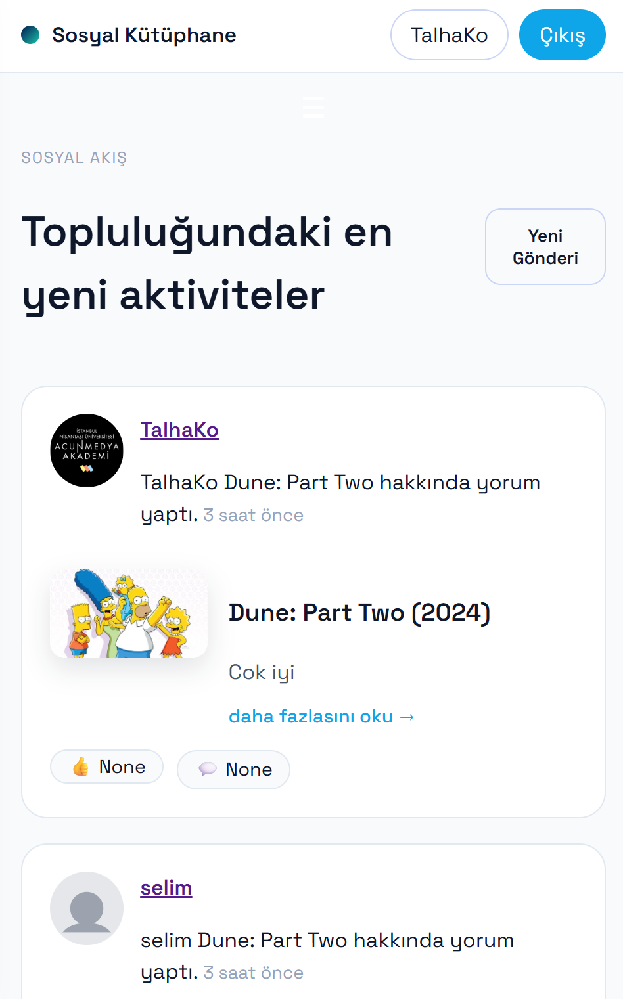

# YazLab2 - Sosyal Kutuphane

YazLab2, kitap ve film iceriklerinin kesfedilebildigi, puanlanabildigi ve yorumlanabildigi Flask tabanli bir sosyal kutuphane uygulamasidir.

## Ozellikler

- Kullanci kaydi ve girisi (JWT tabanli kimlik dogrulama)
- Kitap/film kesfetme ve detay goruntuleme
- Puan verme, yorum yazma ve yorumlara tepki birakma
- Kisisel kutuphane yonetimi (izlenecek, izlendi, okunacak, okundu)
- Ozel listeler olusturma ve listeye icerik ekleme
- Takip sistemi ve aktivite akisi
- Sifremi unuttum akisi ve e-posta ile sifirlama
- Mobil uyumlu arayuz + PWA destegi

## Ekran Goruntuleri

### Ana akis



### Profil sayfasi



### Mobil gorunum



## Teknoloji Yigini

- Python
- Flask
- SQLAlchemy
- Flask-JWT-Extended
- SQLite (gelistirme ortami)
- Jinja2 + CSS + JavaScript

## Kurulum

### 1) Projeyi klonla

```bash
git clone <repo-url>
cd yazlab2
```

### 2) Sanal ortam olustur ve aktif et

Windows PowerShell:

```powershell
python -m venv .venv
Set-ExecutionPolicy -Scope Process -ExecutionPolicy RemoteSigned
.\.venv\Scripts\Activate.ps1
```

macOS/Linux:

```bash
python3 -m venv .venv
source .venv/bin/activate
```

### 3) Bagimliliklari yukle

```bash
pip install -r requirements.txt
```

### 4) Ortam degiskenlerini ayarla

Kok dizinde `.env` dosyasi olusturun. Gelistirme icin ornek:

```env
SECRET_KEY=devsecret
JWT_SECRET_KEY=dev-jwt-secret
DATABASE_URL=sqlite:///instance/app.db

TMDB_API_KEY=your_tmdb_key
GOOGLE_BOOKS_API_KEY=your_google_books_key

SMTP_HOST=smtp.gmail.com
SMTP_PORT=587
SMTP_USER=your_email@gmail.com
SMTP_PASS=your_app_password
MAIL_FROM=your_email@gmail.com
APP_BASE_URL=http://127.0.0.1:5000
RESET_TOKEN_EXPIRATION=3600

ADMIN_KEY=my-secret-admin-key
```

Not: Harici API anahtarlari olmadan da uygulama temel seviyede calisir; bazi kesfetme senaryolari sinirli olabilir.

## Calistirma

```bash
python app.py
```

Uygulama varsayilan olarak su adreste calisir:

`http://127.0.0.1:5000`

## API Notlari

- Ana API prefix'i: `/api`
- Admin DB ozeti endpoint'i: `/api/admin/db-summary`
- Admin endpoint'leri icin header gerekir:

```text
X-Admin-Key: <ADMIN_KEY>
```

## Proje Yapisi

```text
app.py                  # Web route'lari ve uygulama giris noktasi
backend/
	api/                  # REST endpoint'ler
	models/               # SQLAlchemy modelleri
	clients.py            # TMDb ve Google Books/OpenLibrary istemcileri
	mail.py               # E-posta gonderim yardimcisi
	security.py           # Sifre hash/dogrulama
data/                   # Ornek veri
docs/                   # Teknik dokumanlar
static/                 # CSS, PWA dosyalari, statik varliklar
templates/              # Jinja2 sayfa sablonlari
```

## Guvenlik ve Notlar

- Gercek gizli bilgileri (API key, SMTP sifresi vb.) repoya commitlemeyin.
- Public yayin oncesi `.env` dosyasinin repoda olmadigini dogrulayin.
- Uretim ortami icin SQLite yerine PostgreSQL gibi bir veritabani onerilir.

## Lisans

Bu proje egitim amaclidir.

